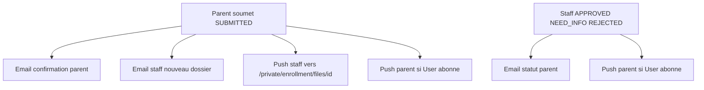

# Notifications inscriptions (email + push)

Résumé opérationnel du branchement **mail + Web Push** sur le cycle d’inscription scolaire, et des règles associées (corbeille, listes d’élèves).

Voir aussi :

- [Module Inscription Scolaire](./Module-Inscription-Scolaire.md) — workflow dossiers / campagnes
- [PWA](./PWA.md) — abonnement push, service worker, clés VAPID
- [Prisma Middleware - cryptoData.md](./Prisma%20Middleware%20-%20cryptoData.md) — `EnrollmentFile.email` / `formPayload` chiffrés
- [middleware.md](./middleware.md) — lien public `/enrollment/[token]` (pas de 401)
- API technique : [`src/app/api/notification/README.md`](../../src/app/api/notification/README.md)
- Cron corbeille cPanel : [`cron/README.md`](../../cron/README.md)

---

## En une phrase

Quand un parent **soumet** un dossier → confirmation **email parent** + alerte **email + push staff**.  
Quand le staff **décide** (approuvé / à compléter / refusé) → **email parent** (déjà en place) + **push parent** si un compte `User` abonné est trouvable.

---

## Qui reçoit quoi

| Événement | Email parent | Push parent | Email staff | Push staff |
|-----------|--------------|-------------|-------------|------------|
| Invitation (création dossier) | Oui (lien token) | — | — | — |
| Soumission `SUBMITTED` | Oui (confirmation) | Si User abonné | Oui (tous `MANAGE_ENROLLMENTS` + SUPER_ADMIN) | Oui (idem, si abonnés) |
| `NEED_INFO` / `APPROVED` / `REJECTED` | Oui | Si User abonné | — | — |

**Staff** = utilisateurs dont le rôle porte le privilège `MANAGE_ENROLLMENTS`, plus `SUPER_ADMIN`.

**Push parent** : uniquement si un `User` existe (même email que le dossier, ou membre de la `familyId`) **et** qu’il a une `PushSubscription`.  
Le parcours public `/enrollment/[token]` sans compte ne peut pas s’abonner (la table `PushSubscription` exige un `userId`).

---

## Flux



---

## Fichiers clés

| Rôle | Fichier |
|------|---------|
| Orchestration métier | `src/lib/services/enrollment/enrollment-notify.service.ts` |
| Envoi Web Push serveur | `src/lib/services/web-push.service.ts` |
| Branchement soumission / statut | `src/lib/services/enrollment/file.service.ts` |
| Email parent (statuts) | `src/lib/nodemailer/enrollment-status-change.email.ts` |
| Email invitation | `src/lib/nodemailer/enrollment-invitation.email.ts` |
| Email staff soumission | `src/lib/nodemailer/enrollment-staff-submitted.email.ts` |
| API HTTP push (auth) | `POST /api/notification/notify` |
| Abonnement / désabonnement | `/api/notification/subscribe`, `/unsubscribe` |
| Toggle staff (menu) | `NotificationToggle` |
| Opt-in sur formulaire public | `EnrollmentPushOptInBanner` (session User → activer ; sinon rappel email) |

Les appels métier passent par **`web-push.service`** (pas un `fetch` interne vers l’API). L’API `notify` réutilise le même service.

---

## Opt-in push

1. **Staff / comptes connectés** : cloche `NotificationToggle` dans le menu utilisateur.
2. **Formulaire public** : bandeau en haut du dossier  
   - pas de session → texte « infos par email » ;  
   - session User → bouton « Activer les notifications ».

Sans opt-in, seuls les **emails** partent (canal fiable pour les familles hors app).

---

## Variables d’environnement

```env
NEXT_PUBLIC_APP_URL=https://votredomaine.fr
SMTP_FROM=...
# Push
NEXT_PUBLIC_VAPID_PUBLIC_KEY=...
VAPID_PRIVATE_KEY=...
WEB_PUSH_EMAIL=contact@votredomaine.fr
```

Génération des clés : `npx web-push generate-vapid-keys` (détails dans [PWA.md](./PWA.md)).

---

## Contenu des messages (rappel)

- **Staff soumission** : « Dossier soumis », email famille + campagne, CTA vers `/private/enrollment/files/[id]`.
- **Parent décision (push)** : textes courts — reçu / infos demandées / accepté / refusé — + lien `/enrollment/[token]`.
- **Parent email** : templates HTML existants (confirmation, complément, acceptation, refus).

Les échecs mail/push sont capturés en `try/catch` : ils **ne font pas échouer** la soumission ni le changement de statut.

---

## Hors scope (volontaire)

- Inbox notifications persistées en BDD (`notification.service.ts` reste un stub).
- Abonnement push anonyme lié au seul `token` (il faudrait un modèle sans `userId`).
- SMS.

---

## Rappels utiles autour du module (session récente)

### Corbeille dossiers (soft-delete)

- `DELETE` dossier → `deletedAt` (pas d’effacement immédiat).
- Récupérable **30 jours** (`ENROLLMENT_SOFT_DELETE_RETENTION_DAYS`).
- Bouton corbeille ↔ récupérer ; purge via cron cPanel (`cron/enrollment-purge.js` + `CRON_SECRET`).
- Suppression **campagne** : interdite si date de fin non passée ou s’il reste des dossiers (y compris corbeille).

### Affichage des élèves dans les listes

Avant `APPROVED`, les enfants sont dans le `formPayload`, pas encore en `EnrollmentStudent`.  
Les listes (cartes, vue d’ensemble) utilisent `enrollmentChildLabels()` pour afficher les noms depuis le formulaire ou les liens élèves.

### Feedback UI

Les toasts de succès/erreur des mutations viennent de `useApiMutation` (feedback API). Ne pas re-toaster dans les `onSuccess` locaux (doublons).
