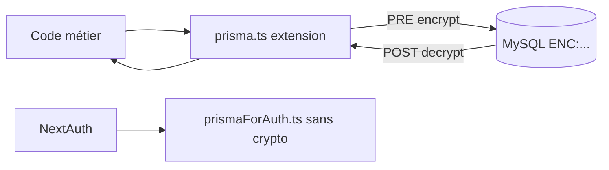

# Chiffrement transparent Prisma (extension crypto)

Guide à jour du chiffrement / déchiffrement automatique des champs sensibles via Prisma.

> Ne pas confondre avec le **middleware Next.js** d’auth/routes : voir [middleware.md](./middleware.md).

---

## 1. Vue d’ensemble

Le système :

- **chiffre** certains champs string **avant** écriture (`create` / `update`) ;
- **déchiffre** à la lecture (`find*`, et aussi après `create` / `update` / `upsert` pour renvoyer du clair à l’app) ;
- est **transparent** pour le code métier qui utilise `import { prisma } from "@/lib/prisma/prisma"` ;
- stocke les valeurs au format `ENC:<ciphertext>` (AES via `crypto-js`).

Sans la variable d’environnement `ENCRYPTION_KEY`, les données chiffrées sont **irrécupérables**.

---

## 2. Architecture actuelle (Prisma 6)

Prisma 6 n’a plus `$use`. La logique vit dans une **extension** `$extends` + `$allModels.$allOperations` dans [`src/lib/prisma/prisma.ts`](../../src/lib/prisma/prisma.ts).

```plaintext
src/lib/prisma/
├── prisma.ts                          # Client étendu (chiffrement)
├── prismaForAuth.ts                   # Client sans crypto (NextAuth)
├── prisma-middleware.types.ts
└── Prisma-Middleware/
    ├── crypto-fields.util.ts          # Listes de champs + encrypt/decrypt helpers
    ├── UserMiddleware.ts
    ├── StudentMiddleware.ts
    ├── MedicalInformationMiddleware.ts
    ├── FamilyMiddleware.ts
    ├── EnrollmentFileMiddleware.ts    # + déchiffrement imbriqué (family, students, reviewer)
    ├── EnrollmentSignatureMiddleware.ts
    ├── ContactMiddleware.ts           # EmergencyContact + AuthorizedPickup
    ├── EnrollmentCampaignMiddleware.ts  # post (relations), pas de champs crypto dédiés
    ├── EstablishmentMiddleware.ts
    ├── classRoomMiddleware.ts
    ├── ClassRoomPersonnelMiddleware.ts
    └── CommissionMiddleware.ts
```



### Deux clients Prisma

| Client | Import | Usage |
|--------|--------|--------|
| Principal | `@/lib/prisma/prisma` | Tout le métier (avec chiffrement) |
| Auth | `@/lib/prisma/prismaForAuth` | NextAuth uniquement (évite les conflits crypto / credentials) |

---

## 3. Service crypto

Fichier : [`src/lib/services/crypto.service.ts`](../../src/lib/services/crypto.service.ts)

| Fonction | Rôle |
|----------|------|
| `encrypt` | AES + préfixe `ENC:` ; ne rechiffre pas si déjà préfixé |
| `decrypt` / `safeDecrypt` | Déchiffre si `ENC:` ; sinon retourne tel quel |

Helpers dans `crypto-fields.util.ts` :

- `encryptDataFields(data, fields)` — mutates `args.data` avant écriture
- `decryptRecordFields(record, fields)` — copie déchiffrée d’un enregistrement

---

## 4. Catalogue des champs chiffrés

Source de vérité : [`crypto-fields.util.ts`](../../src/lib/prisma/Prisma-Middleware/crypto-fields.util.ts) (+ `EnrollmentSignatureMiddleware` pour l’email de signature).

### User

Chiffrés : `name`, `firstName`, `phoneNumber`, `socialSecurityNum`, `address`, `city`, `postalCode`, `profession`, `bio`  

**Non chiffré (volontaire)** : `email` — unique + auth NextAuth.

### Student

`firstName`, `lastName`, `birthPlace`, `previousSchool`, `currentClass`, `custodyArrangement`, `insuranceProvider`, `insuranceNumber`, `insuranceCertificate`, `legalGuardians`

### MedicalInformation

`fileNumber`, `healthBooklet`, `medicalCertificate`, `healthDetails`, `doctorName`, `preferredHospital`, `parentRecommendations`  

(`studentId` reste en clair pour la relation.)

### Family

`name`, `notes`

### EmergencyContact / AuthorizedPickup

Prénom, nom, relation, téléphones (+ `identityDocument` pour pickup).

### EnrollmentFile (inscriptions)

`email`, `decisionNote`, `formPayload` (JSON du formulaire public, parents + enfants + santé, etc.)

Au **POST** lecture, le middleware déchiffre aussi les relations imbriquées si présentes :

- `family` (+ `members.user`)
- `students[].student`
- `reviewer`

### EnrollmentSignature

`email` (destinataire de signature)

### Autres middlewares

`Establishment`, `ClassRoom`, `ClassRoomPersonnel`, `Commission`, `EnrollmentCampaign` : post-traitement (souvent relations / logo), **pas** de liste de champs AES dans `crypto-fields.util.ts`.

---

## 5. Cycle PRE / POST

**PRE** (écriture) — modèles avec chiffrement :

`User`, `Student`, `MedicalInformation`, `Family`, `EnrollmentFile`, `EmergencyContact`, `AuthorizedPickup`, `EnrollmentSignature`

Actions : `create`, `update` (selon middleware).

**POST** (lecture / retour) — déchiffrement sur :

`findMany`, `findFirst`, `findUnique`, `create`, `update`, `upsert` (liste exacte selon chaque fichier middleware).

---

## 6. Implications pour le module inscriptions

| Sujet | Conséquence |
|-------|-------------|
| `EnrollmentFile.email` chiffré | Un `where: { email: "a@b.c" }` en clair **ne matchera pas** la valeur `ENC:…` en base. Filtrer autrement (id, token, liste puis filtre app) ou accepter la limite. |
| `formPayload` chiffré | Toujours passer par `prisma` étendu ; parser le JSON **après** lecture (ex. `parsedFormPayload`). |
| Notifications / mails | Utiliser l’email **déjà déchiffré** renvoyé par le service après `findUnique` / `update`. |
| Affichage élèves en liste | Les enfants du formulaire sont dans `formPayload` ; `enrollmentChildLabels()` parse ce payload déchiffré. |

Voir aussi [Notifications-Inscriptions.md](./Notifications-Inscriptions.md).

---

## 7. Ajouter un champ / un modèle

1. Ajouter le nom du champ dans la constante `*_SENSITIVE_FIELDS` (ou liste locale du middleware).
2. S’assurer que le PRE / POST du modèle est branché dans `prisma.ts` (`encryptionExtension`).
3. Colonne MySQL en `TEXT` / `LongText` si besoin (ciphertext plus long).
4. Ne **jamais** chiffrer un champ utilisé comme clé unique d’auth ou de recherche fréquente sans stratégie dédiée (ex. `User.email`).

Exemple d’extension (conceptuel) :

```typescript
// crypto-fields.util.ts
export const ENROLLMENT_FILE_SENSITIVE_FIELDS = [
  "email",
  "decisionNote",
  "formPayload",
  // "nouveauChamp",
] as const;
```

Pas besoin de toucher chaque query métier : PRE/POST s’appliquent globalement.

---

## 8. Limites

1. **Pas de recherche SQL** fiable sur champs chiffrés.
2. **Pas de tri / index** utiles sur le ciphertext.
3. **Coût CPU** sur gros `findMany` (ex. listes de dossiers avec `formPayload`).
4. **Double chiffrement** : `encrypt` refuse de rechiffrer si préfixe `ENC:` déjà présent ; éviter de repasser une valeur déjà chiffrée manuellement.
5. **Perte de clé** = perte des données sensibles.

---

## 9. Configuration

```env
ENCRYPTION_KEY=clé_aléatoire_de_32_caractères_minimum
```

Génération (exemple) :

```bash
node -e "console.log(require('crypto').randomBytes(32).toString('base64'))"
```

Une clé **différente** par environnement ; ne jamais committer la clé.

---

## 10. Bonnes pratiques

1. Toujours importer `@/lib/prisma/prisma` pour le métier.
2. Réserver `prismaForAuth` à NextAuth.
3. Documenter ici tout nouveau champ chiffré.
4. Tester encrypt → DB → decrypt round-trip (préfixe `ENC:`).
5. Prévoir une procédure de **rotation de clé** (re-chiffrement batch) avant de changer `ENCRYPTION_KEY` en prod.

---

## 11. Historique / doc obsolète

L’ancienne doc décrivait `prisma.$use` et un seul champ `User.name`.  
Cette page remplace cette description : extension Prisma 6 + catalogue multi-modèles ci-dessus.
